<p align="center">
  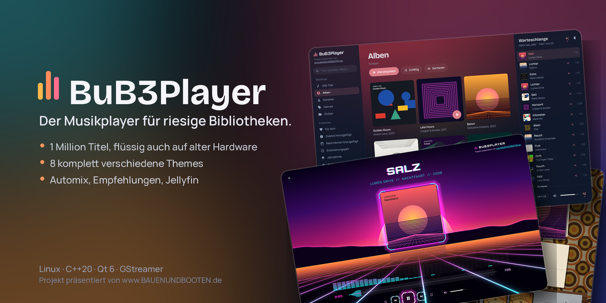
</p>

<p align="center">
  <a href="https://github.com/1100101-Ich-Liebe-Dich/bub3player/releases/latest"></a>
  
  
  
  
  
  <a href="LICENSE"></a>
</p>

<h3 align="center">Eine Million Titel. Acht Welten. Ein Player, der zuhört.</h3>

<p align="center">
  BuB3Player spielt deine komplette Sammlung – lokal und vom Jellyfin-Server – flüssig auch auf
  altem Blech. Er hört jeden Titel einmal an, kennt danach Tempo, Tonart und Lautheit und mischt
  wie ein DJ. Er lernt, was du magst, ohne dass irgendetwas deinen Rechner verlässt.
</p>

<p align="center">
  <a href="#-installieren"><b>Installieren</b></a> ·
  <a href="#-acht-themes-acht-welten"><b>Themes</b></a> ·
  <a href="#-was-er-kann"><b>Funktionen</b></a> ·
  <a href="#-gemessen-nicht-geschätzt"><b>Messwerte</b></a> ·
  <a href="#-für-bastler"><b>Für Bastler</b></a> ·
  <a href="CHANGELOG.md"><b>Änderungen</b></a>
</p>

<p align="center"><sub>Projekt präsentiert von <a href="https://www.bauenundbooten.de"><b>www.BAUENUNDBOOTEN.de</b></a></sub></p>

<br>

## ⚡ Auf einen Blick

<table>
<tr>
<td width="33%" valign="top">

### 📚 Riesige Bibliotheken
**1 000 000 Titel** in 87 Sekunden eingelesen, danach öffnet „Alle Titel“ in unter einer halben
Sekunde. Scrollen bleibt flüssig, egal wie lang die Liste ist.

</td>
<td width="33%" valign="top">

### 🎨 Acht komplette Themes
Kein Farbwechsel, sondern acht eigene Oberflächen: vom ruhigen Klassik über Milchglas und
Plattenspieler bis zur 90er-Stereoanlage und zum grünen Terminal.

</td>
<td width="33%" valign="top">

### 🎧 Automix wie ein DJ
Übergänge auf dem Schlag, ohne Stille, mit zwei Wiedergabe-Decks und sample-genauen Blenden.
Album-Titel bleiben natürlich lückenlos.

</td>
</tr>
<tr>
<td valign="top">

### ✨ Empfehlungen, die lernen
Radio, Autoplay und „Für dich“ – gelernt aus deinem Hörverlauf, nur auf deinem Rechner. Kein
Konto, keine Cloud, kein Tracking.

</td>
<td valign="top">

### ☁️ Jellyfin eingebaut
Server-Titel landen in derselben Bibliothek wie deine lokalen Dateien. Streaming im Original,
lückenlos, mit Rückmeldung an den Server.

</td>
<td valign="top">

### 🪶 Sparsam
Unter **300 MB** Arbeitsspeicher, auch während im Hintergrund die ganze Sammlung analysiert wird.
Gebaut für Rechner, die schon ein paar Jahre auf dem Buckel haben.

</td>
</tr>
</table>

<br>

## 🎨 Acht Themes, acht Welten

<p align="center">
  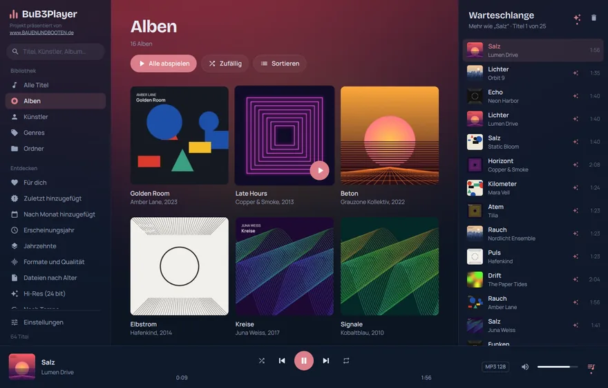
</p>

Jedes Theme hat seinen eigenen Aufbau, eigene Effekte und eigene Einstellungen – Inhalte und
Funktionen sind überall dieselben. Umschalten mit `Strg + T`; jedes Theme merkt sich seine
Einstellungen für sich. Die meisten Themes reagieren auf die Musik: Spektrum, Pegel, Takt.

<table>
<tr>
<td width="50%"></td>
<td width="50%">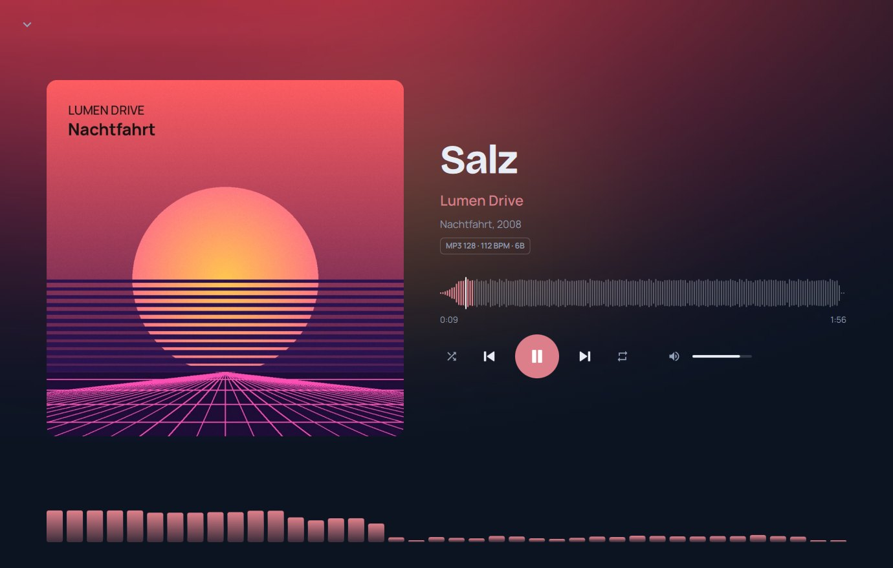</td>
</tr>
<tr><td colspan="2">

**Klassik** – ruhige Seitenleiste, Leuchten aus dem Cover, Wellenform zum Spulen. Sieben
Farbschemata und beliebig viele eigene als JSON.

</td></tr>
<tr>
<td>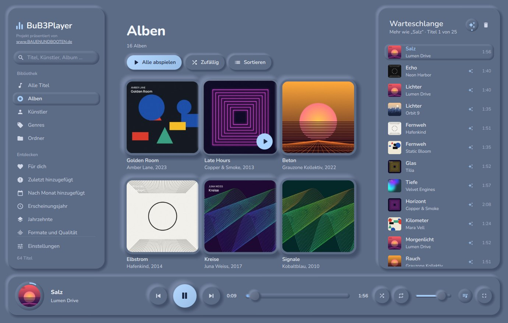</td>
<td>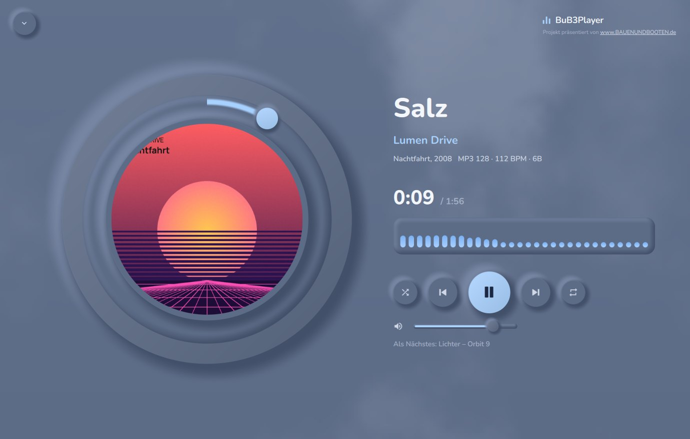</td>
</tr>
<tr><td colspan="2">

**Soft** – Neumorphism: Karten und Tasten wachsen weich aus der Fläche. Die Großansicht ist eine
Drehscheibe mit Fortschrittsring, dahinter ziehen Wolken, die sanft der Musik folgen.

</td></tr>
<tr>
<td>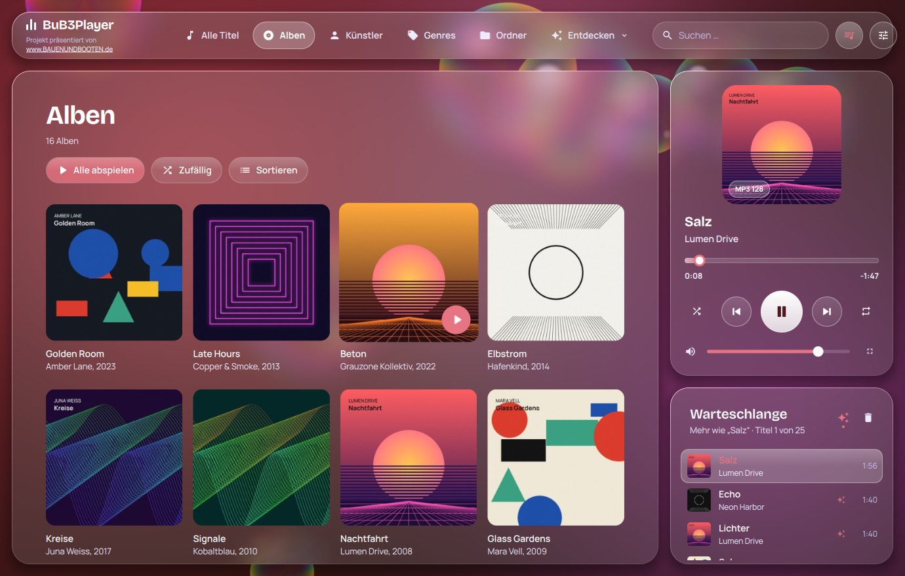</td>
<td>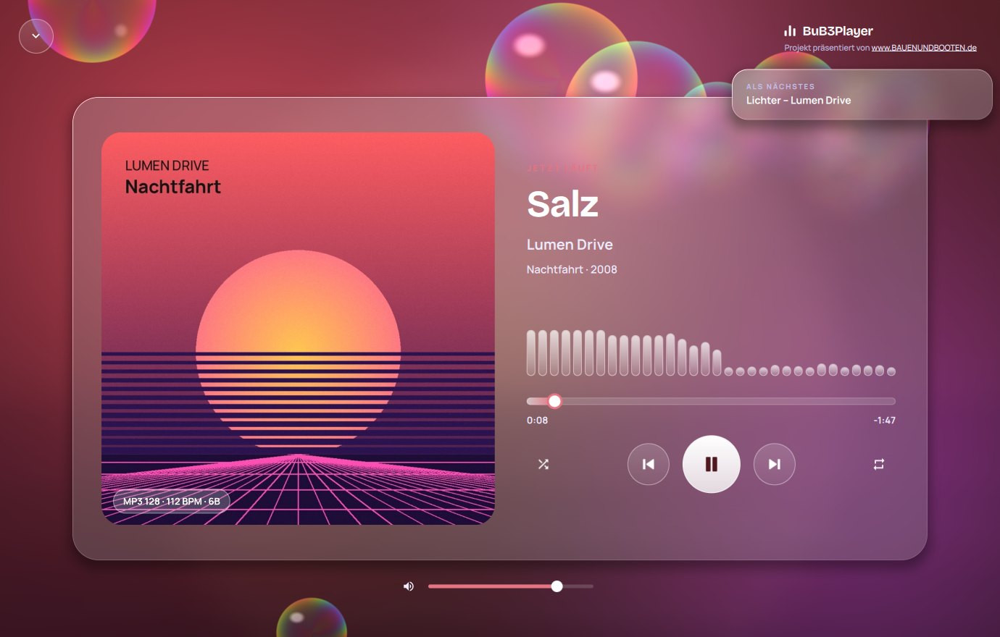</td>
</tr>
<tr><td colspan="2">

**Glas** – Glassmorphism: Milchglas-Karten über schillernden Seifenblasen, die langsam aufsteigen
und mit der Musik atmen. Die Farben kommen aus dem Cover.

</td></tr>
<tr>
<td>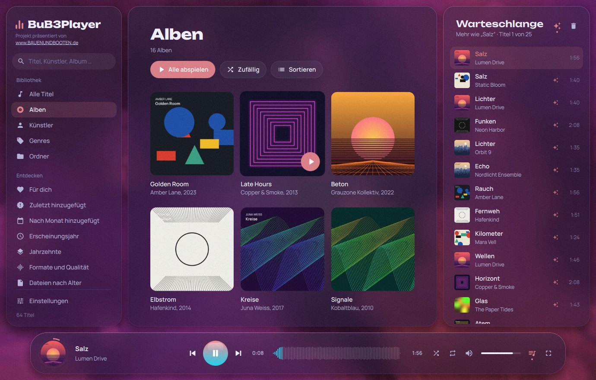</td>
<td>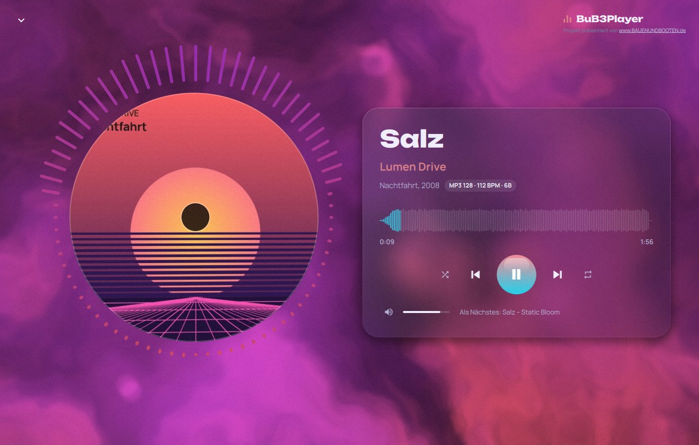</td>
</tr>
<tr><td colspan="2">

**Aurora** – fließendes Polarlicht in den Cover-Farben, irisierende Glaskanten, ein Dock mit
Fortschrittsring und eine drehende Cover-Scheibe mit Rundum-Spektrum.

</td></tr>
<tr>
<td>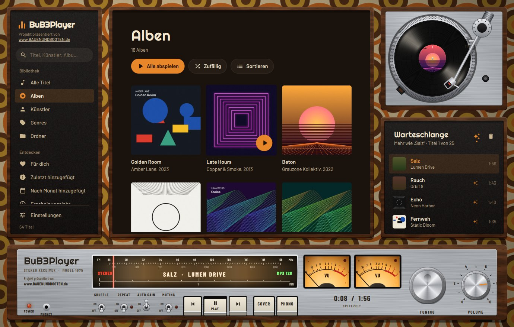</td>
<td>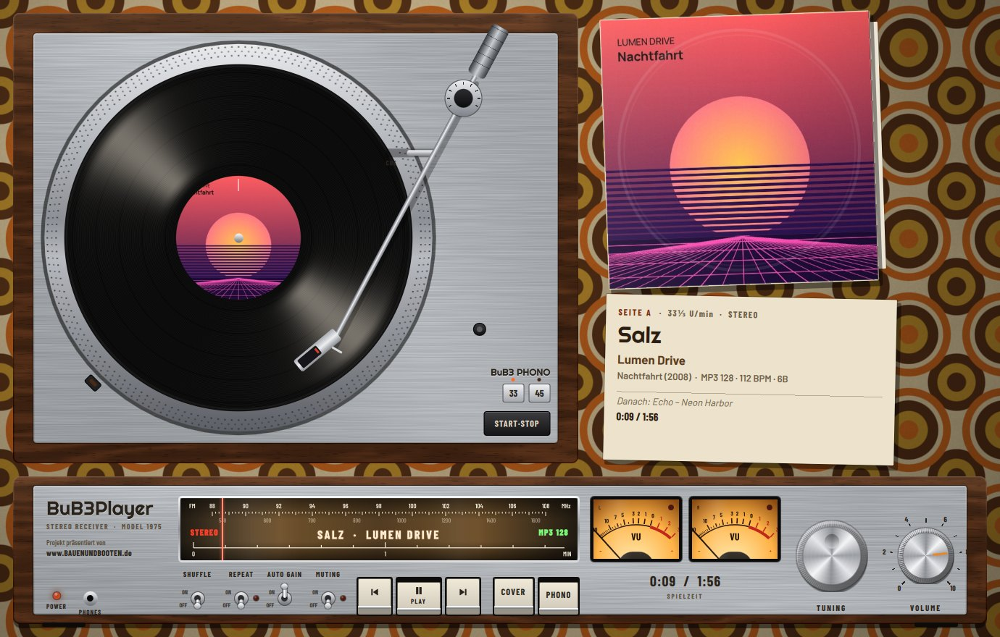</td>
</tr>
<tr><td colspan="2">

**Vintage** – ein Wohnzimmer der 70er: Tapete, Nussbaum, Receiver mit beleuchteter Senderskala,
glühenden Lämpchen und VU-Metern. Der rote Zeiger ist die Spielposition, `TUNING` spult, `PHONO`
öffnet den großen Plattenspieler mit Tonarm und Stroboskop.

</td></tr>
<tr>
<td>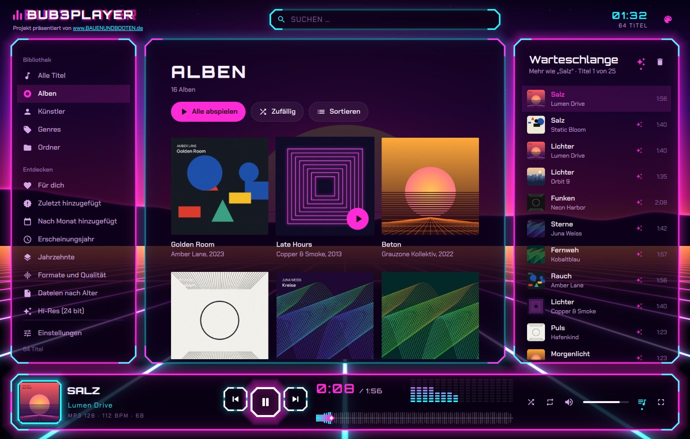</td>
<td>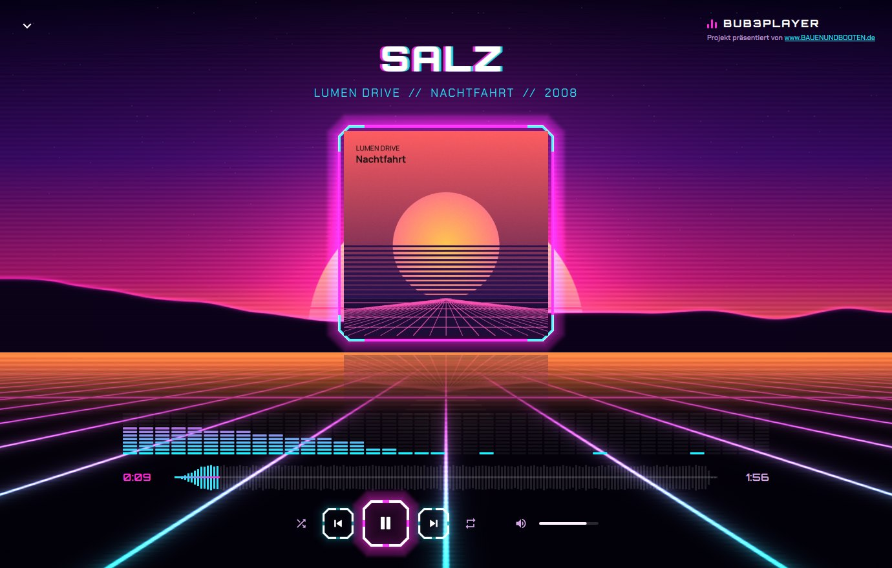</td>
</tr>
<tr><td colspan="2">

**Synthwave** – Retro-Sonne, Neon-Gitter im Takt, HUD-Panels, LED-Spektrum und ein kurzer Glitch
bei jedem Titelwechsel.

</td></tr>
<tr>
<td>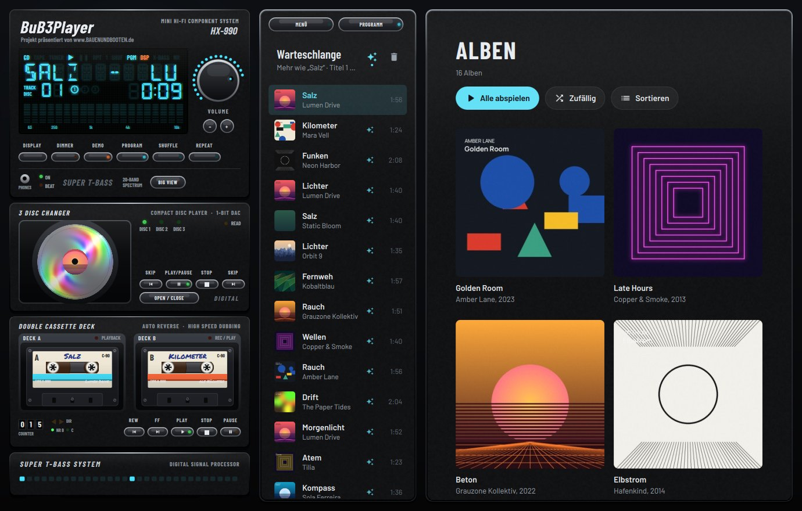</td>
<td>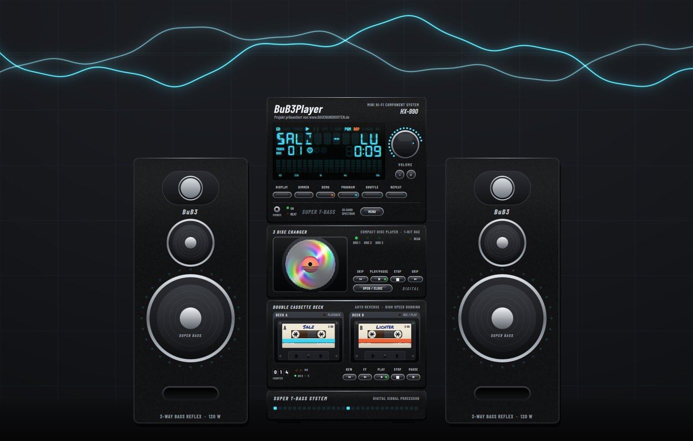</td>
</tr>
<tr><td colspan="2">

**Hi-Fi Turm** – die Minianlage aus den 90ern: Leuchtdisplay mit 14-Segment-Lauftext,
20-Band-Spektrum, Lautstärkerad mit LED-Kranz, CD-Wechsler und Doppel-Kassettendeck mit
drehenden Spulen. Darüber ein Oszilloskop, das Bässen, Mitten und Höhen folgt.

</td></tr>
<tr>
<td>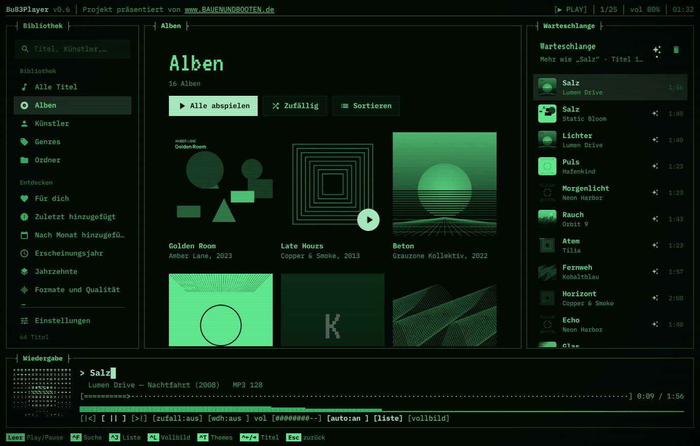</td>
<td>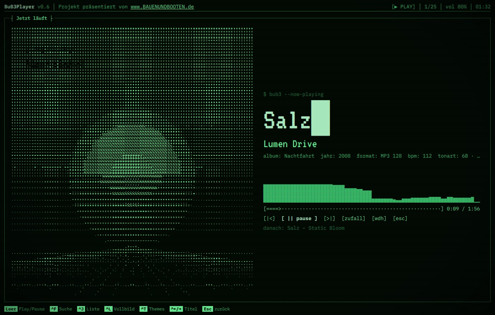</td>
</tr>
<tr><td colspan="2">

**Terminal** – Textmodus auf einer Bildröhre: Kästen aus Linien, Cover als ASCII-Art, Spektrum
aus Blockzeichen, `[====>····]` als Fortschritt. In Phosphor-Grün, Bernstein, Papierweiß oder
im Stil des Brotkastens.

</td></tr>
</table>

> [!TIP]
> **Alter Rechner?** Einstellungen → Allgemein → **Leistung**: Sparmodus, Animationen im
> Hintergrund anhalten, Musik-Analyse aus. Jedes animierte Theme hat zusätzlich
> „Animation: Sparsam/Aus“. Ohne GPU-Beschleunigung schalten alle Themes von selbst auf einfache
> Flächen um.

<br>

## 🚀 Was er kann

### 🎧 Automix und Audioanalyse

BuB3Player hört jeden Titel genau einmal an – in einer eigenen, gedrosselten Pipeline, unabhängig
von der Wiedergabe – und merkt sich, was er gehört hat:

| Gemessen | Wofür |
|---|---|
| **Tempo** (BPM, Sicherheit, erster Schlag) | Übergänge auf dem Schlag, Ansicht „Nach Tempo“, ruhiger Fluss im Radio |
| **Tonart** in Camelot-Schreibweise (`8A` = a-Moll) | harmonisch passende Folgen, Ansicht „Nach Tonart“ |
| **Lautheit** nach EBU R128 (integriert, Spannweite, Spitze) | gleiche Lautstärke auch ohne ReplayGain-Tags |
| **Anfang, Einblenden, Ausblenden, Ende** | Stille fällt weg, Übergänge beginnen an der richtigen Stelle |
| **Energie, Helligkeit, Anschläge pro Sekunde** | Empfehlungen, die zur Stimmung passen |
| **Wellenform** | Spulen per Klick in die Welle |

Rund **0,5 Sekunden** für vier Minuten FLAC. Der laufende und der nächste Titel kommen sofort
dran, der Rest der Sammlung nebenbei: **Sanft** (ein Drittel eines Kerns, pausiert, wenn der Rechner
zu tun hat), **Zügig** oder **Nur Gespieltes**. Ein Abbruch schadet nicht, es geht beim nächsten
Start weiter.

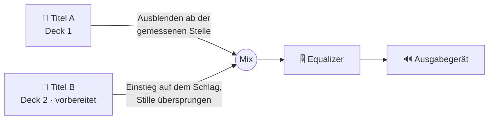

**Drei Arten von Übergängen:**
- **Lückenlos** – wie auf der CD, ohne die kleinste Pause.
- **Überblenden** – gleich laute Überblendung, 1 bis 15 Sekunden.
- **Automix** – Stille am Anfang und Ende fällt weg. Endet ein Titel mit eigenem Ausblenden,
  kommt der nächste mitten hinein. Passt das Tempo, wird länger und auf dem Schlag gemischt;
  passt es nicht, kürzer. Ein langsames Intro darf selbst einblenden. Titel eines Albums, die
  aufeinander folgen, bleiben lückenlos.

<table>
<tr>
<td width="50%">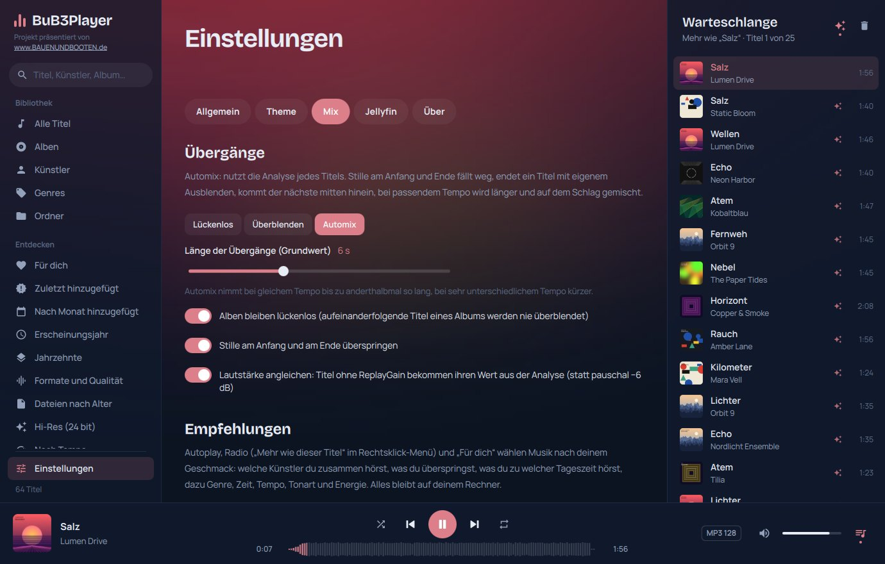</td>
<td width="50%">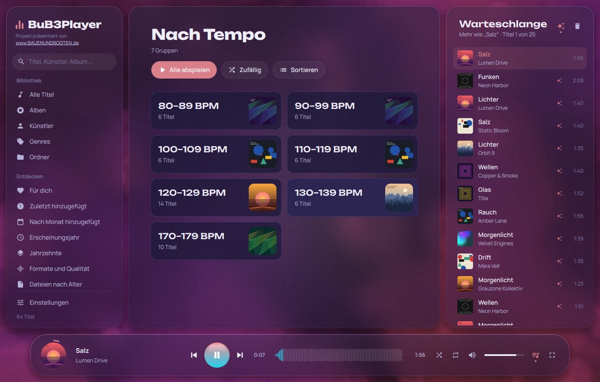</td>
</tr>
</table>

### ✨ Empfehlungen, Radio und „Für dich“

Der Player lernt **nur auf deinem Rechner** aus dem, was du hörst: welche Künstler in einer
Sitzung zusammen laufen, was du überspringst, was du zu welcher Tageszeit magst – dazu Genre,
Jahrzehnt, Tempo, Tonart und Energie.

- **Radio** – „Mehr wie dieser Titel“ oder „Radio dazu starten“ für Album, Künstler oder Genre.
  Die Warteschlange füllt sich von selbst weiter. Überspringst du einen Vorschlag früh, gibt es
  von diesem Künstler für den Rest der Sitzung weniger – schon geplante Titel werden ersetzt.
- **Autoplay** – geht die Warteschlange zu Ende, geht die Musik passend weiter.
- **Für dich** – „Weiter wie zuletzt“, dein Mix zur Tageszeit, „Wiederentdecken“ (früher oft
  gehört, lange nicht mehr) und „Neu für dich“ (nie gehört, aber nah an deinen Lieblingen).
- Gewichteter Zufall statt fester Listen: nie zweimal dieselbe Auswahl, keine Häufung eines
  Künstlers oder Albums. Wählbar von **Vertraut** über **Ausgewogen** bis **Abenteuerlich**.
- Lernen abschaltbar, Gelerntes mit einem Klick gelöscht. Vorgeschlagene Titel tragen in der
  Warteschlange ein kleines Funkeln.

<table>
<tr>
<td width="50%">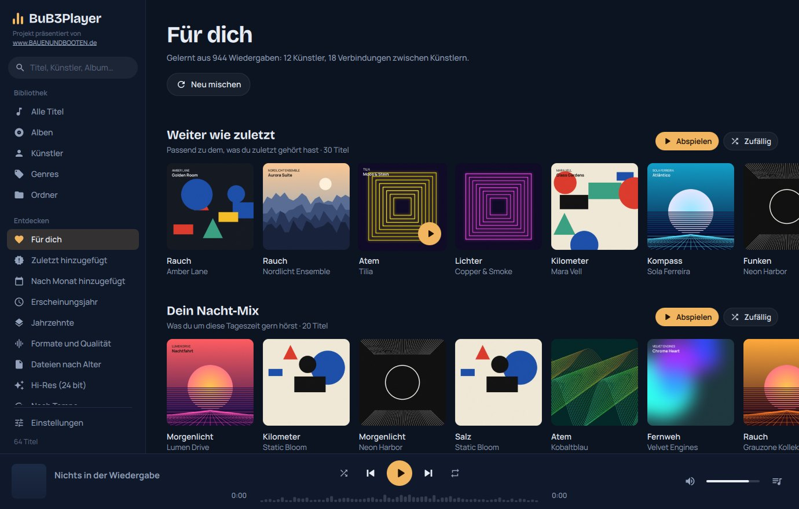</td>
<td width="50%">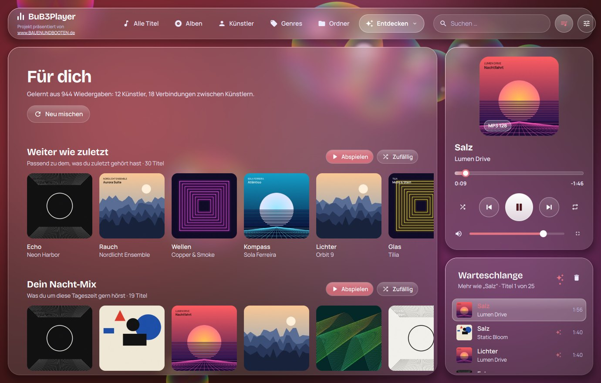</td>
</tr>
</table>

### 📚 Bibliothek und Ansichten

- **Scanner in zwei Phasen**: erst die Ordner (die Bibliothek ist sofort benutzbar), dann die Tags
  im Hintergrund in Plattenreihenfolge. Unveränderte Dateien werden nicht angefasst, ein
  abgebrochener Scan läuft beim nächsten Mal weiter. Auf HDDs automatisch weniger Lese-Threads.
- **Nichts geht verloren**: Ausgehängte Laufwerke oder ein weggebrochenes Netzwerk löschen
  **nie** etwas aus der Bibliothek. Symlink-Schleifen und doppelt eingebundene Ordner werden erkannt.
- **Ansichten**: Alle Titel, Alben als Cover-Raster, Künstler, Genres, **Ordner wie auf der
  Platte**, Zuletzt hinzugefügt, nach Monat, Erscheinungsjahr, Jahrzehnte, Formate und Qualität
  („FLAC 24 bit, 96 kHz“), Hi-Res, Dateien nach Alter, **Nach Tempo**, **Nach Tonart**,
  meistgespielt, lange nicht gehört, nie gespielt.
- **Jede Liste sortierbar** nach Titel, Künstler, Album, Jahr, Hinzugefügt, Genre, Format, Dauer,
  Wiedergaben, Tempo, Energie, Dateipfad …
- **Künstlerbilder** aus dem Ordner des Künstlers: Liegt die Musik als `MUSIK/KÜNSTLER/ALBUM/…`
  oder `MUSIK/KÜNSTLER/EPs/ALBUM/…`, nimmt der Player das Bild im Künstler-Ordner (`artist.jpg`,
  `folder.jpg`, `poster.jpg` …). Bei Jellyfin das Künstlerbild des Servers. Ohne Bild: das Cover.
- **A–Z-Leiste** bei Alben und Künstlern: Buchstaben anklicken oder an der Leiste entlangziehen.
- **Volltextsuche** über alles, mit Präfixsuche und ohne Rücksicht auf Akzente – in unter 0,1 s.
  Oben passende **Künstler**, darunter passende **Alben** (jeweils zum Seitwärtsblättern), dann
  die Titel.
- **Eigene Ansichten** als kleine JSON-Datei ([siehe unten](#-für-bastler)).

<p align="center">
  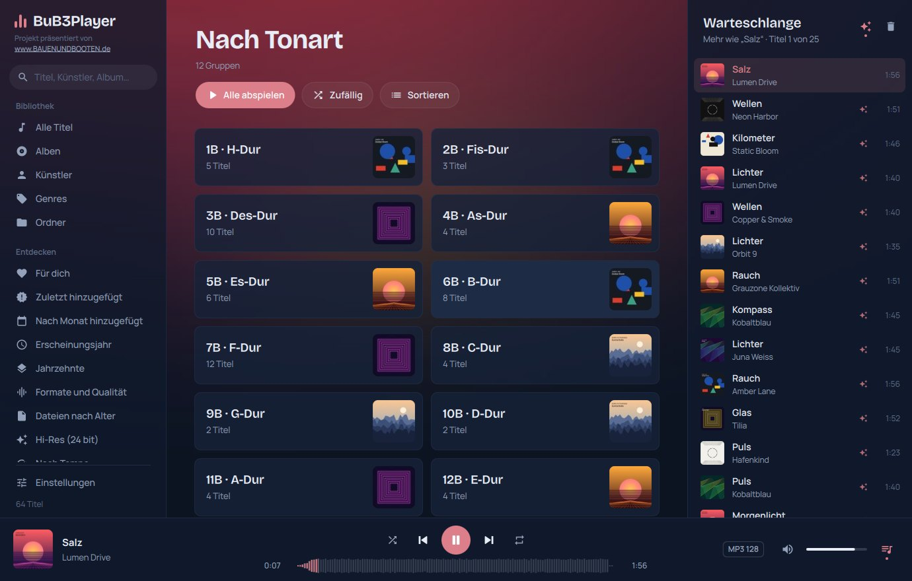
</p>

### 📝 Playlists und Smart-Playlists

- **Playlists** anlegen und aus jeder Liste und jedem Rechtsklick-Menü heraus ergänzen – einzelne
  Titel, eine Auswahl (Strg/Umschalt + Klick), ganze Alben, Künstler, Ordner oder die Warteschlange.
  Die Reihenfolge änderst du per Drag & Drop.
- **Nichts fällt heraus**: Ist ein Titel gerade nicht da (Laufwerk abgezogen, Datei verschoben,
  Server aus), bleibt er in der Playlist und wird von selbst wieder verknüpft, sobald er auftaucht.
- **Smart-Playlists** aus Regeln, die sich von selbst aktuell halten: alle Felder der Bibliothek
  sind erlaubt, auch **Tempo, Tonart und Energie** – zum Beispiel *„Hi-Res, 120–130 BPM, lange
  nicht gehört, höchstens 50 Titel, zufällig“*.
- **Import und Export** als M3U/M3U8 – deine Listen aus anderen Playern kommen mit, auch mit
  relativen Pfaden für den USB-Stick.

<table>
<tr>
<td width="50%">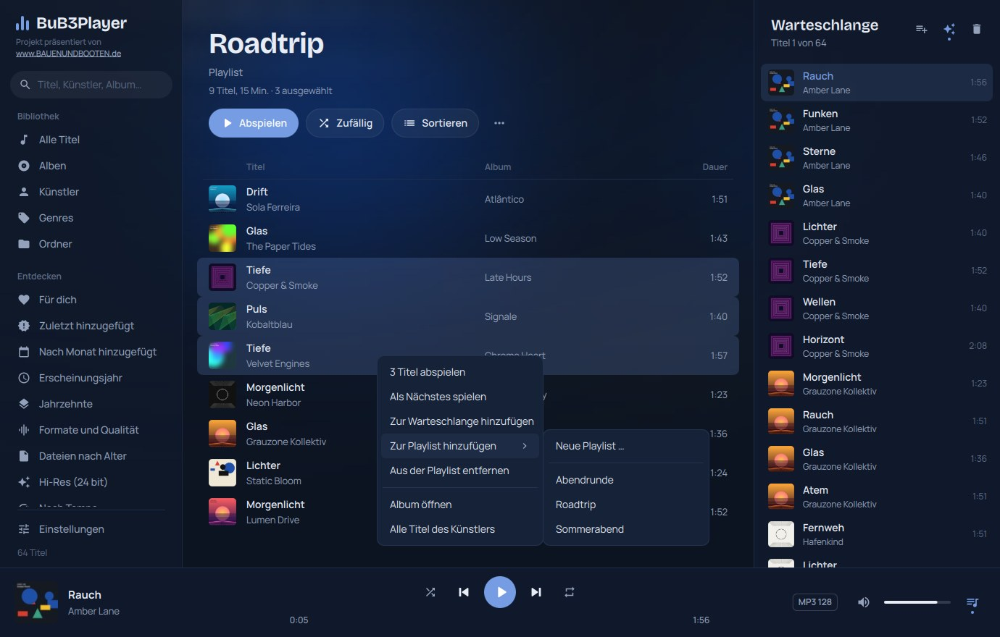</td>
<td width="50%">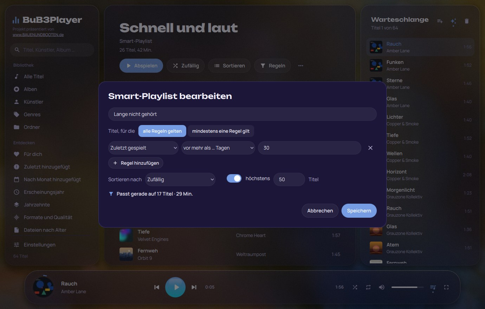</td>
</tr>
</table>

### 👀 Ordnerüberwachung

Neue, geänderte, verschobene und gelöschte Dateien erscheinen **nach wenigen Sekunden** in der
Bibliothek – ohne Neu-Scan, ohne Knopfdruck. Gelesen wird nur der Ordner, in dem sich etwas getan
hat. Ein wieder eingestecktes Laufwerk wird sofort eingelesen, Netzlaufwerke prüft der Player in
Abständen. Auch hier gilt: Ein ausgehängtes Laufwerk löscht nichts.

### 🎚️ Klang

Alles unter **Einstellungen → Klang** (`Strg + E`):

- **Lückenlos** (gapless) auf Sample-Ebene.
- **ReplayGain** für Titel oder Album, mit Limiter und Vorverstärkung. Titel ohne Tags werden über
  die gemessene Lautheit angeglichen (Bezug −18 LUFS wie ReplayGain 2).
- **10-Band-Equalizer** (31 Hz bis 16 kHz) mit 14 Voreinstellungen, eigenen gespeicherten Kurven
  und Vorverstärkung – automatisch so viel leiser, wie das lauteste Band anhebt, damit nichts
  übersteuert. Ausgeschaltet ist er gar nicht erst in der Kette.
- **Ausgabegerät wählen** – Kopfhörer, Boxen, HDMI … direkt im Player, ohne Umweg über die
  Systemeinstellungen. Ist das Gerät weg, spielt der Player über den Systemstandard weiter und
  versucht es beim nächsten Titel, den du startest, wieder.
- **Bit-Perfect über ALSA**: Jeder Titel kommt in seiner eigenen Abtastrate und Bittiefe beim DAC
  an, Sample für Sample wie in der Datei – kein Soundserver, keine Software-Lautstärke, nichts
  umgerechnet. Die Einstellungen zeigen, was gerade beim Gerät ankommt („24 Bit · 96 kHz → Gerät:
  32 Bit · 96 kHz ✓“). Kann das Gerät eine Abtastrate nicht, rechnet der Player sie um und sagt es.
  Weil der Ton dann ohne Lautstärkeregler mit voller Stärke ankommt, fragt der Player vor dem
  Einschalten nach: erst Verstärker, DAC oder Kopfhörer leise stellen, dann bestätigen.
- Formate: FLAC, MP3, Ogg Vorbis, Opus, WAV, AIFF, AAC/ALAC, WavPack, Musepack, WMA, APE – alles,
  was GStreamer abspielt.

<p align="center">
  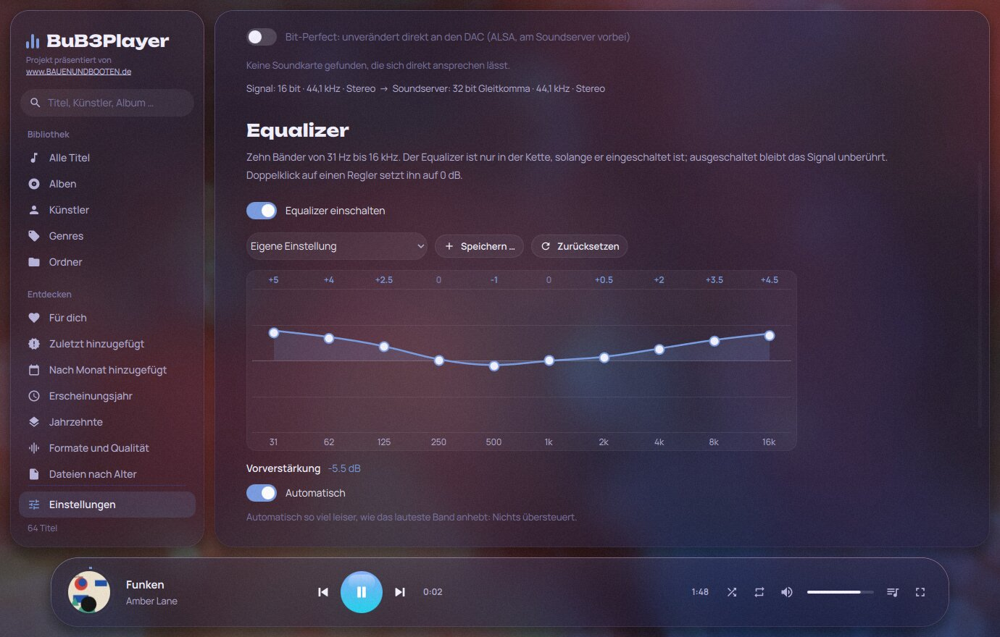
</p>

> **Ohne Equalizer und mit „Systemstandard“** läuft die Wiedergabe genau wie in Version 1.0 –
> kein zusätzliches Element in der Kette, der Ton geht unverändert an den Soundserver.
- Formate: FLAC, MP3, Ogg Vorbis, Opus, WAV, AIFF, AAC/ALAC, WavPack, Musepack, WMA, APE – alles,
  was GStreamer abspielt.

### ☁️ Jellyfin

- **Anmelden** mit Benutzer und Passwort oder per **Quick Connect**. Gespeichert wird nur der
  Zugangsschlüssel, nie das Passwort. Mehrere Server gehen auch.
- **Eine Bibliothek für alles**: Server-Titel erscheinen in allen Ansichten, in der Suche, in
  Radio und Empfehlungen und in der Ordneransicht mit der Ordnerstruktur des Servers.
- **Schneller Abgleich**: zuerst 1000 Titel pro Anfrage, danach nur noch Geändertes. Fällt der
  Server aus, bleibt alles stehen.
- **Streaming im Original** (lückenlos, ReplayGain bleibt) oder umgewandelt mit 320/192/128 kbit/s.
- **Rückmeldung an den Server**: Wiedergaben zählen in Jellyfin mit, BuB3Player erscheint im
  Dashboard als Gerät.
- **Doppelte ausblenden**: Was es lokal und auf dem Server gibt, wird einmal gezeigt und lokal
  gespielt.

<p align="center">
  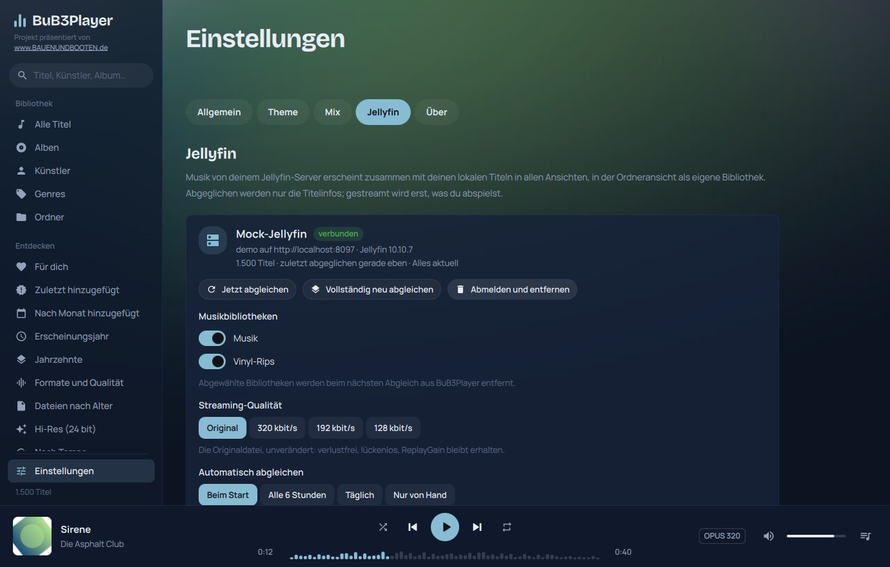
</p>

### ⌨️ Bedienung

| Taste | Aktion |
|---|---|
| `Leertaste` | Abspielen / Pause |
| `Strg + →` / `Strg + ←` | Nächster / vorheriger Titel |
| `Strg + ↑` / `Strg + ↓` | Lauter / leiser |
| `Strg + F` | Suchen |
| `Strg + J` | Warteschlange |
| `Strg + L` | Großansicht |
| `F11` | Vollbild an und aus |
| `Strg + T` | Theme wechseln |
| `Strg + E` | Klang: Ausgabe und Equalizer |
| `Strg + A` | Alle Titel der Liste markieren |
| `Strg + Klick` / `Umschalt + Klick` | Mehrere Titel markieren |
| `Alt + ←` | Zurück |
| `Strg + Q` | Beenden |

Doppelklick spielt ab, Rechtsklick bietet „Als Nächstes spielen“, „Zur Warteschlange“, „Mehr wie
dieser Titel“ und mehr. Die Sitzung bleibt erhalten: Warteschlange, Titel und Position.
**MPRIS** ist dabei – Medientasten, Desktop-Widgets, KDE Connect und `playerctl` funktionieren.

<br>

## 📦 Installieren

### AppImage – herunterladen und loslegen

Lade die Datei `BuB3Player-x86_64.AppImage` aus den
[**Releases**](https://github.com/1100101-Ich-Liebe-Dich/bub3player/releases/latest) und starte sie:

```sh
chmod +x BuB3Player-x86_64.AppImage
./BuB3Player-x86_64.AppImage
```

Läuft ohne Installation und ohne Root-Rechte auf jeder x86-64-Distribution ab Ubuntu 22.04,
Debian 12, Fedora 36 oder Linux Mint 21 – Arch, Manjaro und Co. sowieso.
Beim ersten Start auf **„Musikordner hinzufügen“** klicken – die ersten Titel erscheinen schon
während des Scans.

<details>
<summary><b>Selbst bauen</b> (Arch, Fedora, Debian, Ubuntu)</summary>

<br>

**Arch / Manjaro / EndeavourOS**
```sh
sudo pacman -S --needed base-devel cmake ninja qt6-base qt6-declarative qt6-svg qt6-shadertools \
  gstreamer gst-plugins-base gst-plugins-good gst-libav taglib sqlite
```

**Fedora**
```sh
sudo dnf install gcc-c++ cmake ninja-build qt6-qtbase-devel qt6-qtdeclarative-devel qt6-qtsvg-devel \
  qt6-qtshadertools-devel gstreamer1-devel gstreamer1-plugins-base-devel gstreamer1-plugins-good \
  gstreamer1-libav taglib-devel sqlite-devel
```

**Debian 13 / Ubuntu 24.04+**
```sh
sudo apt install build-essential cmake ninja-build qt6-base-dev qt6-declarative-dev qt6-svg-dev \
  qt6-shadertools-dev libgstreamer1.0-dev libgstreamer-plugins-base1.0-dev gstreamer1.0-plugins-good \
  gstreamer1.0-libav gstreamer1.0-alsa libtag1-dev libsqlite3-dev qml6-module-qtquick qml6-module-qtquick-controls \
  qml6-module-qtquick-layouts qml6-module-qtquick-window qml6-module-qtquick-dialogs \
  qml6-module-qtquick-templates qml6-module-qtqml-workerscript
```

**Bauen und starten**
```sh
git clone https://github.com/1100101-Ich-Liebe-Dich/bub3player.git
cd bub3player
cmake -S . -B build -G Ninja -DCMAKE_BUILD_TYPE=Release
cmake --build build
./build/halcyon
# optional systemweit:
sudo cmake --install build
```

`gst-libav` wird für AAC/ALAC, WMA und APE gebraucht. MP3, FLAC, Ogg, Opus und WAV laufen ohne.

</details>

<br>

## 📊 Gemessen, nicht geschätzt

Testrechner: VM mit 2 vCPUs, 8 GB RAM, SSD – **1 000 000 Dateien in 101 000 Ordnern**.

| Vorgang | Zeit | Speicher |
|---|---:|---:|
| Erstimport, Phase 1 (ab hier ist die Bibliothek benutzbar) | **22 s** | |
| Erstimport komplett (Tags, Sortier- und Suchindex) | **87 s** | 128 MB Spitze |
| Erneuter Scan, nichts geändert | **5 s** | 58 MB |
| „Alle Titel“ mit 1 Mio Zeilen öffnen | **< 0,5 s** | ~100 MB |
| Volltextsuche | **< 0,1 s** | |
| Audioanalyse, 3:51 min FLAC | **0,54 s** | |
| Dauertest: Analyse „Zügig“, Titelsprünge, Blättern | | **295 MB** gesamt, stabil |
| Dauertest: Automix-Übergänge im Minutentakt | | **266–272 MB** gesamt, stabil |

<details>
<summary><b>Genauigkeit der Audioanalyse</b></summary>

<br>

Geprüft mit erzeugten Testtiteln, bei denen Tempo, Tonart und Lautheit bekannt sind:

| Was | Ergebnis |
|---|---|
| Tempo, 30 Titel mit Schlagzeug, 84–176 BPM | alle auf **±0,2 BPM**; Rauschen ohne Takt: Sicherheit 0 |
| Tonart | Dur und Moll mit Leitton richtig; Moll-Stücke aus denselben Akkorden wie die Parallel-Dur zeigen die Parallel-Dur (gleiche Camelot-Zahl, mischt genauso) |
| Lautheit gegenüber `ffmpeg ebur128` | **±0,1 LU** bei Musik |
| Stille, Ein- und Ausblenden | auf 0,1 s genau, Ausblenden erkannt ab −6 dB unter dem Titel |

</details>

<details>
<summary><b>Arbeitsspeicher im Detail</b></summary>

<br>

Gemessen mit 1 080 Titeln und 360 Covern in 2000 × 2000 px, Fenster 1380 × 880, Grafik über
Mesa llvmpipe (Software-OpenGL, zählt seine Puffer mit). „Eigene Daten“ ist der anonyme Speicher
des Players, „gesamt“ enthält zusätzlich geteilte Bibliotheken und Grafiktreiber.

| Situation | eigene Daten | gesamt |
|---|---:|---:|
| ein Theme, Wiedergabe, Alben durchblättern, Großansicht | 108–165 MB | 239–296 MB |
| 4 min Dauerbelastung: alle 1,6 s Theme wechseln, Titel springen, blättern | 200–250 MB | ~380 MB |
| dasselbe mit Software-Renderer (`QT_QUICK_BACKEND=software`) | 80–90 MB | ~160 MB |

Was dafür sorgt: Listen halten nur IDs (8 Byte pro Titel) und laden sichtbare Zeilen seitenweise.
Cover werden nur in der angezeigten Größe dekodiert und nur, solange sie zu sehen sind. Nach jedem
Theme-Wechsel, im Hintergrund und alle drei Minuten wird aufgeräumt und freier Speicher ans System
zurückgegeben. Einstellungen → Allgemein → Leistung zeigt den Verbrauch live.

Auf einer **HDD** bestimmt beim Erstimport die Platte das Tempo. Phase 1 und alle späteren Scans
bleiben schnell, und die Bibliothek ist schon während Phase 2 benutzbar. Selbst messen:

```sh
halcyon --scan /pfad/zur/musik --db /tmp/test.db
```

Mehr: [docs/benchmark.md](docs/benchmark.md)

</details>

<br>

## 🔧 Für Bastler

<details>
<summary><b>Eigene Ansichten</b> – Listen nach deinen Regeln, als JSON</summary>

<br>

`~/.config/halcyon/views.json` (Vorlage: `views.example.json` im selben Ordner):

```json
[
  {
    "id": "hires-jazz",
    "name": "Hi-Res Jazz",
    "icon": "sparkle",
    "kind": "tracks",
    "spec": {
      "filters": [
        { "field": "genre", "op": "contains", "value": "Jazz" },
        { "field": "bits",  "op": "ge",       "value": 24 }
      ],
      "sort": "year",
      "desc": true
    }
  }
]
```

- `kind`: `tracks` (Liste) oder `groups` (mit `"layout": "grid"` oder `"tiles"` und `spec.groupBy`)
- Felder: `title artist album albumArtist genre composer codec filename year decade bits sampleRate
  bitrate added mtime playCount skipCount lastPlayed duration rating folder addedMonth fileYear
  quality bpm tempo key energy loudness`
- Operatoren: `eq ne lt le gt ge contains startsWith empty notEmpty withinDays olderThanDays under`
  (`under` = Ordner inklusive Unterordner, Wert ist ein Pfad)
- Sortierung: `album title artist year added mtime duration playCount lastPlayed codec genre path
  bpm energy random`
- Gruppierung: `album albumArtist artist genre year decade quality addedMonth fileYear composer
  tempo key`

Alle Werte werden als Parameter gebunden, Felder und Operatoren sind auf eine feste Liste begrenzt.

</details>

<details>
<summary><b>Eigene Farbschemata und Themes</b></summary>

<br>

**Farbschema für Klassik:** JSON-Datei nach `~/.local/share/halcyon/themes/` legen, z. B. eine
Kopie von `themes/01-tiefsee.json` mit neuer `id`. Gleiche `id` überschreibt ein mitgeliefertes
Schema.

**Neues Theme:** eine Beschreibung in `skins/<id>.json` (Name, Schriften, Farbschemata,
Einstellungs-Schema) und eine QML-Datei in `qml/skins/`. Die Einstellungsseite wird aus dem Schema
erzeugt (Typen `palette`, `bool`, `range`, `choice`).

</details>

<details>
<summary><b>Kommandozeile</b></summary>

<br>

```sh
halcyon --add-folder ~/Musik          # Musikordner hinzufügen
halcyon --skin vintage                # mit einem bestimmten Theme starten
halcyon --view albums                 # mit einer bestimmten Ansicht starten
halcyon --scan ~/Musik --db test.db   # Scan ohne Oberfläche, mit Zeitmessung
halcyon --analyze titel.flac          # Tempo, Tonart, Lautheit … eines Titels ausgeben
halcyon --recommend 4711              # zeigen, was nach Titel 4711 käme
```

Alles weitere: `halcyon --help`

</details>

<details>
<summary><b>Aufbau des Codes</b></summary>

<br>

```
src/core      Datenbank (SQLite, WAL, FTS5), Scanner, TagReader, Cover- und Icon-Provider
src/library   Abfragen (QueryBuilder), Listen-, Gruppen- und Ordnermodelle, Ansichten
src/player    GStreamer-Player (zwei Decks, Überblenden), Warteschlange, MPRIS
src/analysis  Audioanalyse (Tempo, Tonart, Lautheit, Übergänge, Wellenform), Hintergrund-Warteschlange
src/recommend Empfehlungen: Lernen aus dem Hörverlauf, Auswahl, Autoplay, Radio, „Für dich“
src/jellyfin  Anmeldung, Abgleich, Streaming-Adressen, Rückmeldung an den Server
src/ui        Theme-System
qml/          gemeinsame Seiten und Bausteine
qml/skins/    die acht Themes
skins/        Theme-Beschreibungen, Einstellungs-Schemata, Vorschaubilder
themes/       Farbschemata für Klassik
shaders/      Aurora-Licht, Milchglas, Neumorphism, Synthwave-Szene, Vinyl, CD, Bildröhre …
tools/        Testwerkzeuge: Vorführ- und Riesen-Bibliothek erzeugen, Klick- und
              Speichertests, mock-jellyfin.py (kleiner Server mit der Jellyfin-API)
dist/         Desktop-Eintrag, AppStream, Symbol, AppImage-Skripte
```

Daten: `~/.local/share/halcyon/` (Datenbank, Warteschlange, eigene Themes),
`~/.config/halcyon/` (Einstellungen, eigene Ansichten), `~/.cache/halcyon/` (Cover, Wellenformen).

**Grundsätze:** Alles, was dauert, läuft außerhalb des UI-Threads. Jede optionale
GStreamer-Komponente wird vorher geprüft; fehlt sie, fällt nur die Funktion weg, nie die Wiedergabe.

Wer mitentwickeln möchte: [CLAUDE.md](CLAUDE.md) fasst Vorgaben, Aufbau, Tests und Fahrplan
zusammen.

Zum Ausprobieren ohne eigenen Jellyfin-Server:
`tools/mock-jellyfin.py --audio <ordner>` (Benutzer `demo`, Passwort `demo`).

</details>

<br>

## 🔭 Ausblick

BuB3Player ist und bleibt ein **Linux-Player**. Ideen für die nächsten Versionen:

- 🎤 **Liedtexte** – aus den Tags oder einer `.lrc` daneben, synchronisiert in der Großansicht
  (Klick auf eine Zeile springt dorthin), auf Wunsch von **LRCLIB** *(in Arbeit)*
- 📂 Titel direkt aus dem Dateimanager öffnen („Öffnen mit BuB3Player“)
- 📡 Scrobbeln zu **ListenBrainz** und **Last.fm**
- 🏷️ **Tag-Editor** für einzelne Titel und ganze Alben
- 🪟 **Mini-Player** – klein, immer im Vordergrund
- 😴 **Schlaf-Timer** mit sanftem Ausblenden
- 📱 **Fernbedienung** übers Handy oder den Browser im Heimnetz
- 🖼️ Fehlende **Cover aus dem Netz** ergänzen
- 🌍 **Englische Oberfläche**
- 🎨 Noch mehr Themes

Wünsche und Fehler gerne als [Issue](https://github.com/1100101-Ich-Liebe-Dich/bub3player/issues/new/choose).
Wer mitbauen möchte: [CONTRIBUTING.md](CONTRIBUTING.md). Sicherheitslücken bitte nicht öffentlich,
sondern wie in [SECURITY.md](SECURITY.md) beschrieben melden.

<br>

## 📜 Lizenz

Copyright © 2026 BAUENUNDBOOTEN.de

BuB3Player ist **freie Software** unter der [GNU General Public License, Version 3 oder später](LICENSE)
(GPL-3.0-or-later): Du darfst ihn nutzen, untersuchen, verändern und weitergeben – auch
verändert, solange der Quellcode unter derselben Lizenz offen bleibt. Es gibt keine Gewährleistung.

Was sonst noch dabei ist:

| Teil | Lizenz | Text |
|---|---|---|
| Schriften Manrope, Bricolage Grotesque, Unbounded, Orbitron, Chakra Petch, Barlow, Barlow Condensed, VT323, Nunito, Righteous, IBM Plex Mono, DSEG7/DSEG14 | SIL Open Font License 1.1 | `assets/fonts/OFL-*.txt` |
| Schrift Permanent Marker (© 2010 Font Diner, Inc.), Symbole (Pfade aus Material Icons, © Google LLC) | Apache 2.0 | `assets/fonts/LICENSE-permanentmarker.txt`, `LICENSES/Apache-2.0.txt`, `LICENSES/NOTICE.txt` |
| Qt 6 (im AppImage) | LGPL 3 | `LICENSES/LGPL-3.0.txt` |

**Im AppImage** stecken außerdem Bibliotheken aus Ubuntu 22.04 (GStreamer, FFmpeg über
gst-libav, TagLib, SQLite …) und Qt. Ihre Lizenzen liegen im AppImage unter `usr/share/licenses/`,
die Liste aller Pakete mit Version und Quellpaket in `usr/share/licenses/bub3player/MITGELIEFERT.txt`
(anschauen mit `./BuB3Player-x86_64.AppImage --appimage-extract`). **Den Quellcode** genau dieser
Paketversionen hängt jedes Release als `BuB3Player-<Version>-quellen.tar` neben das AppImage; den
von Qt gibt es unter [download.qt.io/archive/qt](https://download.qt.io/archive/qt/), den des
Players selbst als „Source code“ beim Release.

Alle Künstler, Alben und Cover in den Bildern sind erfunden.

<br>

<p align="center">
  <sub>Gebaut mit C++20, Qt 6, GStreamer, TagLib und SQLite · Interner Projektname <b>Halcyon</b></sub><br>
  <b>Projekt präsentiert von <a href="https://www.bauenundbooten.de">www.BAUENUNDBOOTEN.de</a></b>
</p>
