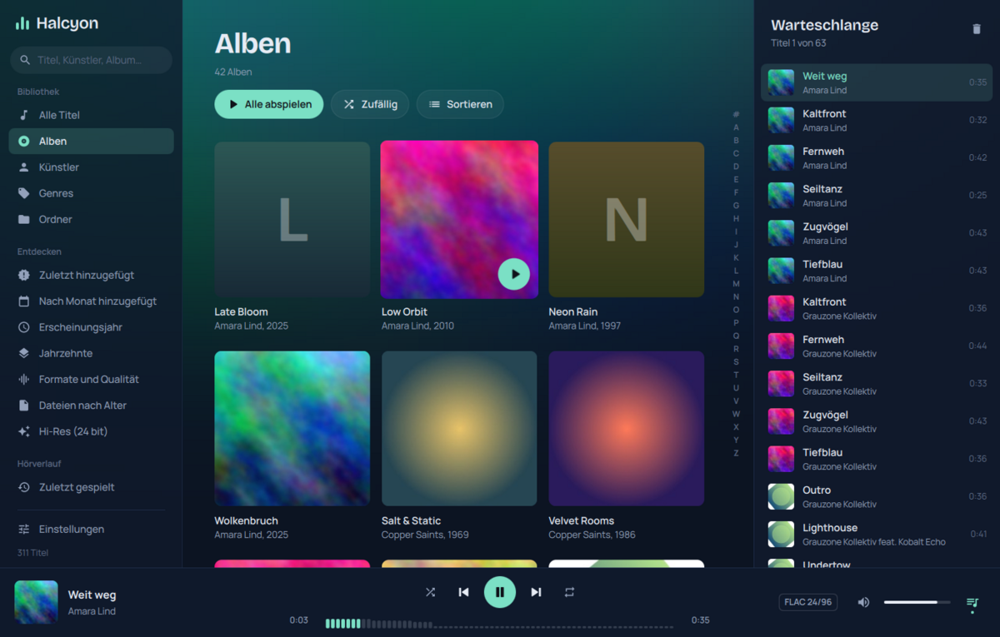

# Halcyon

Musikplayer für Linux, gebaut für **sehr große lokale Bibliotheken** (1 Mio+ Titel) und
später auch für **Jellyfin**. C++20, Qt 6 / QML, GStreamer, TagLib, SQLite.



> Arbeitstitel. Stand: Phase 1 (lokale Bibliothek, Wiedergabe, Ansichten, Themes).
> Jellyfin, Empfehlungen und Automix folgen in den nächsten Phasen (siehe unten).

## Was schon geht

**Bibliothek**
- Inkrementeller Zwei-Phasen-Scanner: erst Ordner (Bibliothek sofort nutzbar), dann Tags im
  Hintergrund in Plattenreihenfolge. Unveränderte Dateien (Größe + Änderungszeit) werden nicht
  angefasst. Ein abgebrochener Scan wird beim nächsten Mal fortgesetzt.
- Nicht erreichbare Laufwerke (ausgehängt, Netzwerk weg) werden **nie** aus der Bibliothek gelöscht.
- Symlink-Schleifen und doppelt eingebundene Ordner werden erkannt.
- Automatisch 2 Lese-Threads auf HDDs (weniger Kopfspringen), mehr auf SSDs; einstellbar.
- Erstimport: Sortier- und Suchindizes werden abgeschaltet und am Ende in einem Rutsch gebaut.

**Ansichten** (alle virtualisiert, auch bei 1 Mio Zeilen flüssig)
- Alle Titel, Alben (Cover-Raster), Künstler, Genres, **Ordneransicht** wie auf der Platte
- Zuletzt hinzugefügt, nach Monat hinzugefügt, Erscheinungsjahr, Jahrzehnte,
  Formate und Qualität (z. B. „FLAC 24 bit, 96 kHz“), **Dateien nach Alter**, Hi-Res
- Hörverlauf: zuletzt gespielt, meistgespielt, lange nicht gehört, nie gespielt
- Jede Liste nach Titel, Künstler, Album, Jahr, Hinzugefügt, Datei-Datum, Genre, Format,
  Dauer, Wiedergaben, Zuletzt gespielt oder Dateipfad sortierbar
- Volltextsuche (SQLite FTS5, Präfixsuche, ohne Akzente)
- **Eigene Ansichten** per JSON (`~/.config/halcyon/views.json`), siehe unten

**Wiedergabe**
- GStreamer: lückenlos (gapless), ReplayGain (Titel/Album) mit Limiter, Vorverstärkung
- Warteschlange mit Zufall (Verlauf bleibt erhalten), Wiederholen, Als Nächstes spielen
- Sitzung wird gespeichert: Warteschlange, Titel und Position
- MPRIS (Medientasten, Desktop-Widgets, KDE Connect, `playerctl`)
- Wiedergabestatistik (Wiedergaben, Skips, Verlauf) als Basis für Empfehlungen

**Oberfläche**
- 7 Themes (Tiefsee, Polarlicht, Papier, OLED Schwarz, Fjord, Neon, Wald) + eigene als JSON
- Akzentfarbe und Hintergrund-Leuchten aus dem aktuellen Cover
- Live-Spektrum in der Seek-Leiste und in der Großansicht (nur aktiv, wenn sichtbar)
- Software-Renderer-Fallback für sehr alte Grafik

Weitere Bilder: [Großansicht (Neon)](docs/screenshots/grossansicht-neon.png),
[Album (Polarlicht)](docs/screenshots/album-polarlicht.png), [Genres (Papier)](docs/screenshots/genres-papier.png),
[Ordner (Wald)](docs/screenshots/ordner-wald.png), [Suche](docs/screenshots/suche.png),
[1 Mio Titel](docs/screenshots/eine-million-titel.png)

## Gemessen

Testrechner: VM mit 2 vCPUs, 8 GB RAM, SSD. 1 000 000 Dateien in 101 000 Ordnern.

| Vorgang | Zeit | Speicher |
|---|---|---|
| Erstimport Phase 1 (Ordner, Bibliothek ab hier nutzbar) | 22 s | |
| Erstimport komplett (Tags, Sortier- und Suchindex) | 87 s | 128 MB Spitze |
| Erneuter Scan, nichts geändert | 5 s | 58 MB |
| App mit „Alle Titel“ (1 Mio Zeilen) geöffnet | < 0,5 s | ~100 MB |
| Volltextsuche | < 0,1 s | |

Details: [docs/benchmark.md](docs/benchmark.md)

Wichtig: Beim Test lagen die Dateien im RAM-Cache. Auf einer **HDD** bestimmt beim Erstimport
die Platte das Tempo (jede Datei braucht 1–3 Lesezugriffe). Rechne dort mit deutlich längeren
Zeiten für Phase 2. Phase 1 und alle späteren Scans bleiben schnell, und die Bibliothek ist
schon während Phase 2 benutzbar. Selbst messen:

```sh
halcyon --scan /pfad/zur/musik --db /tmp/test.db
```

## Bauen

Abhängigkeiten:

**Arch / Manjaro / EndeavourOS**
```sh
sudo pacman -S --needed base-devel cmake ninja qt6-base qt6-declarative qt6-svg qt6-shadertools \
  gstreamer gst-plugins-base gst-plugins-good gst-libav taglib sqlite
```

**Fedora**
```sh
sudo dnf install gcc-c++ cmake ninja-build qt6-qtbase-devel qt6-qtdeclarative-devel qt6-qtsvg-devel \
  qt6-qtshadertools-devel gstreamer1-devel gstreamer1-plugins-base-devel gstreamer1-plugins-good \
  gstreamer1-libav taglib-devel sqlite-devel
```

**Debian 13 / Ubuntu 24.04+**
```sh
sudo apt install build-essential cmake ninja-build qt6-base-dev qt6-declarative-dev qt6-svg-dev \
  qt6-shadertools-dev libgstreamer1.0-dev libgstreamer-plugins-base1.0-dev gstreamer1.0-plugins-good \
  gstreamer1.0-libav libtag1-dev libsqlite3-dev qml6-module-qtquick qml6-module-qtquick-controls \
  qml6-module-qtquick-layouts qml6-module-qtquick-window qml6-module-qtquick-dialogs \
  qml6-module-qtquick-templates qml6-module-qtqml-workerscript
```

Bauen und starten:
```sh
cmake -S . -B build -G Ninja -DCMAKE_BUILD_TYPE=Release
cmake --build build
./build/halcyon
# optional systemweit:
sudo cmake --install build
```

`gst-libav` wird für AAC/ALAC, WMA und APE gebraucht. MP3, FLAC, Ogg, Opus und WAV laufen ohne.

## Bedienung

| Taste | Aktion |
|---|---|
| Leertaste | Abspielen / Pause |
| Strg + → / ← | Nächster / vorheriger Titel |
| Strg + ↑ / ↓ | Lauter / leiser |
| Strg + F | Suchen |
| Strg + J | Warteschlange |
| Strg + L | Großansicht |
| Alt + ← | Zurück |
| Strg + Q | Beenden |

Doppelklick spielt ab, Rechtsklick bietet „Als Nächstes spielen“, „Zur Warteschlange“,
„Album öffnen“ usw.

Kommandozeile: `halcyon --help` (u. a. `--add-folder`, `--view`, `--theme`, `--db`, `--scan`).

## Eigene Ansichten

`~/.config/halcyon/views.json` (Vorlage: `views.example.json` im selben Ordner):

```json
[
  {
    "id": "hires-jazz",
    "name": "Hi-Res Jazz",
    "icon": "sparkle",
    "kind": "tracks",
    "spec": {
      "filters": [
        { "field": "genre", "op": "contains", "value": "Jazz" },
        { "field": "bits",  "op": "ge",       "value": 24 }
      ],
      "sort": "year",
      "desc": true
    }
  }
]
```

- `kind`: `tracks` (Liste) oder `groups` (mit `"layout": "grid"` oder `"tiles"` und `spec.groupBy`)
- Felder: `title artist album albumArtist genre composer codec filename year decade bits sampleRate
  bitrate added mtime playCount skipCount lastPlayed duration rating folder addedMonth fileYear quality`
- Operatoren: `eq ne lt le gt ge contains startsWith empty notEmpty withinDays olderThanDays under`
  (`under` = Ordner inklusive Unterordner, Wert ist ein Pfad)
- Sortierung: `album title artist year added mtime duration playCount lastPlayed codec genre path random`
- Gruppierung: `album albumArtist artist genre year decade quality addedMonth fileYear composer`

Alle Werte werden als Parameter gebunden, Felder und Operatoren sind auf eine feste Liste begrenzt.

## Eigene Themes

JSON-Datei nach `~/.local/share/halcyon/themes/` legen, z. B. eine Kopie von
`themes/01-tiefsee.json` mit neuer `id`. Gleiche `id` überschreibt ein mitgeliefertes Theme.

## Aufbau

```
src/core      Datenbank (Schema, WAL, FTS5), Scanner, TagReader, Cover- und Icon-Provider
src/library   Abfragen (QueryBuilder), Listen-/Gruppen-/Ordnermodelle, Ansichten, Library-API für QML
src/player    GStreamer-Player, Warteschlange, MPRIS
src/ui        Theme-System
qml/          Oberfläche
themes/       mitgelieferte Themes
shaders/      Cover-Rundung, Hintergrund-Leuchten
```

Daten: `~/.local/share/halcyon/` (Datenbank, Warteschlange, eigene Themes),
`~/.config/halcyon/` (Einstellungen, eigene Ansichten), `~/.cache/halcyon/covers/` (Cover-Cache).

Grundsätze: Listen halten nur IDs (8 Byte pro Titel) und laden sichtbare Zeilen seitenweise.
Alles, was dauert, läuft außerhalb des UI-Threads. Jede optionale GStreamer-Komponente wird
vorher geprüft; fehlt sie, fällt nur die Funktion weg, nie die Wiedergabe.

## Fahrplan

1. **Phase 1 – fertig:** lokale Bibliothek, Scanner, Ansichten, Wiedergabe, Themes
2. **Phase 2 – Jellyfin:** Anmeldung, inkrementeller Abgleich in dieselbe Datenbank
   (Tabelle `sources` ist schon da), Streaming, Ordneransicht über Jellyfin-Pfade, Scrobbling
3. **Phase 3 – Empfehlungen:** aus dem Hörverlauf (zusammen gehört, Skips, Tageszeit),
   „Mehr wie dieser Titel“, endlose Radio-Warteschlange
4. **Phase 4 – Audioanalyse und Automix:** BPM, Tonart, Energie, Lautheit im Hintergrund;
   Übergänge an Stille-/Intro-Grenzen, Crossfade mit zwei Pipelines
5. **Phase 5:** Equalizer, Ausgabegerät wählen / Bit-Perfect über ALSA, Playlists und
   Smart-Playlists im Editor, Ordnerüberwachung (inotify), Liedtexte, mehr Themes

## Lizenzen

Schriften: Manrope und Bricolage Grotesque, SIL Open Font License (`assets/fonts/`).
Icons: Pfade aus Material Icons (Apache 2.0).
